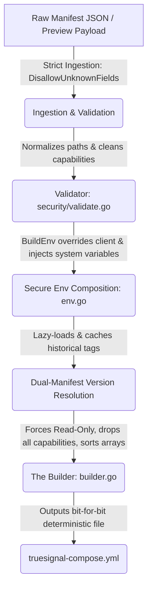

# Hub Secure Compose Compiler Architecture

The `internal/compose` package is responsible for compiling deterministic, hardened `truesignal-compose.yml` configurations served to remote edge nodes. 

To prevent privilege escalation or container escape vulnerabilities, the compiler operates on the principle of **Secure Defaults by Inversion**. Instead of attempt-filtering bad configurations out of an arbitrary map, the compiler explicitly maps specific allowed schema primitives into a locked-down, pre-configured Compose base.

---

## The Compilation Pipeline

### 1. Strict Ingestion
Compose preview payloads and every per-version manifest fetched from the registry for node deployment are decoded with `.DisallowUnknownFields()` (`security.DecodeManifestStrict`), behind a 1 MB size limit. The fetched manifest's `id` and `version` must match what was requested, and sensor IDs and versions are pattern-checked before they are used to build registry URLs. If a manifest contains attributes outside the schema, it is rejected before any compilation logic executes. The registry `index.json` is size-limited (4 MB) but decoded leniently, since it only drives the catalog UI.

### 2. The Validator (`internal/compose/security/validate.go`)
The validation module acts as the security gateway for all manifests and user-provided configuration overrides. It performs:
* **Capability Restriction:** Enforces a strict allowlist of Linux capabilities: `NET_RAW`, `NET_BIND_SERVICE`, `DAC_OVERRIDE`. Any other capability is rejected. `NET_ADMIN` is deliberately excluded (with host networking it controls host routes and firewall).
* **Network Mode Restriction:** `network_mode` must be empty, `host`, `bridge` or `none`; joining another container's namespace is rejected.
* **Volume Path Normalization:** Requires absolute paths without control characters, cleans them (`filepath.Clean()`, so `..` is resolved), rejects `/`, and rejects anything under the forbidden prefixes: `/var/run`, `/run`, `/proc`, `/sys`, `/dev`, `/boot`, `/etc`, `/root`, `/usr`, `/bin`, `/sbin`, `/lib`, `/lib32`, `/lib64`, `/var/lib/docker`, `/var/lib/containerd`, `/var/lib/kubelet`. Blocking `/run` and `/var/run` whole covers the Docker and containerd sockets whichever path the host uses.
* **Safe Interpolation Checking:** Rejects `$` and `{{` in image, network, volume and init-command fields, relying instead on structural builder templates. (Env var defaults are intentionally Wizard templates and are not checked; the builder escapes `$` in env values to `$$` so Docker Compose never interpolates them.)
* **Digest Pinning (`RequirePinnedImages`):** Every main and init image must carry a `sha256:` digest. Unpinned manifests fail compilation with `invalid_manifest` unless the Hub runs with `TS_ALLOW_UNPINNED_IMAGES=true` (development only).

### 3. Secure Environment Composition (`internal/compose/env.go`)
The environment generation pipeline merges variables with a strict priority order:
1. **Manifest Defaults:** Base variables defined in the sensor manifest.
2. **User/Node Overrides:** Safe environment variables requested via the UI or Wizard (ignoring any attempting to override forbidden system environment fields).
3. **System-Injected Constants:** Hardcoded, system-injected values (such as `TS_HUB_KEY`, `TS_SENSOR_ID`) that are unconditionally set by the Hub.

### 4. Versioning and Dual-Manifest Resolution

**Fail closed:** if the manifest for any installed sensor/version cannot be fetched or validated, the whole compose request fails (`422 manifest_unavailable` / `invalid_manifest`). The compiler never returns a compose with a sensor silently missing, because `truesignal apply` runs `up --remove-orphans` and would tear that decoy down.

To support manual upgrades and historical rollbacks, nodes often run versions of a sensor other than the absolute latest catalog version. To prevent compiling incompatible or broken configurations, the compiler uses dual-manifest resolution:
* **Latest Catalog:** Warmed into cache on startup via the central `index.json`.
* **Historical Schemas:** Lazy-loaded and permanently cached via `FetchSpecificManifest` from the configured registry when a legacy node requests its deployed version. If a node is deployed with a legacy tag, the compose preview will render configurations specific to that historical manifest tag rather than defaulting to the newest catalog entry.

### 5. The Builder (`internal/compose/builder.go`)
The builder converts the strictly validated model inputs into a `ComposeFile` struct:
* **Immutable Sandboxing:** Unconditionally forces secure runtime defaults, including `ReadOnly: true`, `CapDrop: ["ALL"]`, and `SecurityOpt: ["no-new-privileges:true"]`, and defaults `user` to `65532:65532` when the manifest sets none. Main-container bind mounts are always read-only.
* **Init Container Baseline:** Init containers get the same `read_only`, `cap_drop: [ALL]` and `no-new-privileges`, plus `network_mode: none`. Their dynamic lure binds (`dynamic_dir_bind`) mount each lure's parent directory read-write so the provisioner can create the file; each file and directory is validated against the mount rules.
* **Bit-for-Bit Determinism:** Output arrays (environment pairs, volume mount paths, initialization chains) are explicitly alphabetically sorted. This ensures that the generated YAML string is perfectly deterministic and predictable.
